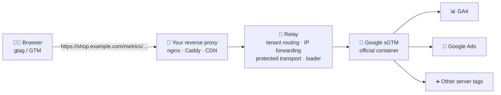

<div align="center">

# 📡 Open Server Side First Party Event Relay

**Open-source, self-hosted first-party tracking relay for server-side Google Tag Manager.**
Send GA4 and Google Ads events through your own domain, keep accurate attribution, and stay in control of your data.

[](LICENSE)
[](https://github.com/HojatGhanad/open-server-side-first-party-event-relay/actions/workflows/ci.yml)
[](https://github.com/HojatGhanad/open-server-side-first-party-event-relay/pkgs/container/fp-relay)


[](CONTRIBUTING.md)
[](https://github.com/HojatGhanad/open-server-side-first-party-event-relay/stargazers)

[🌐 Website](https://hojatghanad.github.io/open-server-side-first-party-event-relay/) ·
[⚡ Quick start](#-quick-start) ·
[📚 Docs](docs/) ·
[⚖️ Comparison](#%EF%B8%8F-how-it-compares) ·
[❓ FAQ](#-faq)

</div>

---

## 🧩 What is it?

**Open Server Side First Party Event Relay** is a lightweight relay that sits between your website and Google's official **server-side Google Tag Manager (sGTM)** container. Your visitors' browsers send measurement requests to **a path on your own domain** (for example `https://shop.example.com/metrics/`). The relay forwards them to sGTM, which then delivers them to **Google Analytics 4 (GA4)**, **Google Ads** and any other tag you configure.

If you know **Stape**, **Addingwell** or **TAGGRS**, the idea will feel familiar: first-party, server-side tagging for GA4 and Google Ads. The difference is that this project is **free, open source (MIT) and runs on your own server**, next to Google's own sGTM image.

## 🤔 Why first-party server-side tracking?

Client-side tracking loses data in ways that are easy to miss:

- 🚫 **Ad blockers and privacy extensions** block requests to `google-analytics.com` and `googletagmanager.com`. Conversions disappear and Google Ads bidding learns from incomplete data.
- 🍪 **Browser cookie limits.** Safari's Intelligent Tracking Prevention (ITP) caps cookies written by JavaScript to 7 days, so returning visitors look like new users and attribution windows shrink.
- 🌍 **Data quality.** A naive proxy sends your server's IP to Google, and every visitor ends up geolocated to your data center.

Routing events through your own domain, with an HTTP-only first-party cookie set by the server, addresses all three.

## ✨ Features

| | |
|---|---|
| 🏠 **First-party collection** | Events go to a path on your own domain, so cookies are set by your server in a true first-party context. |
| 🧠 **Google's official sGTM inside** | The relay forwards to Google's own server container image. Your existing GTM tags, clients and templates keep working. |
| 🌐 **Accurate geolocation** | The real visitor IP, host and scheme are forwarded, so GA4 reports the right country and city. |
| 🛡️ **Protected transport** *(optional)* | GA4 requests are wrapped in an opaque envelope and posted to a random per-site path, so generic filter rules do not match them. |
| 📦 **First-party tag loader** | Serves the GTM loader from your domain, optionally under a path that looks like one of your own assets. |
| 🏢 **Multi-site (multi-tenant)** | One deployment serves many sites. Each hostname gets its own routing, keys and sGTM target in a hot-reloaded `tenants.yml`. |
| 🔁 **Zero-downtime config** | Add or change a site and the relay picks it up within seconds. No restart. |
| 🔍 **Built-in debugging** | Token-protected health, summary and per-event trace endpoints, plus GTM Preview routing. |
| 🖥️ **Operations panel** *(optional)* | Live and historical traffic per site, delivery rate, latency, and tenant management in the browser. |
| 🐳 **Docker-first** | One `docker compose up -d` brings up the relay and sGTM. The relay image is small and runs as non-root. |
| 🌍 **Works in restricted networks** | Ship images over SSH and build through a registry mirror when your server cannot reach public registries. |

## 🧭 How it works



1. Your Google tag is configured with `server_container_url = https://shop.example.com/metrics`.
2. Your reverse proxy routes that path to the relay.
3. The relay identifies the site by hostname, forwards the request (with the visitor's real IP) to sGTM, and passes the first-party `FPID` cookie back to the browser.
4. sGTM runs your server-side tags and sends the data to GA4, Google Ads and others.

## ⚖️ How it compares

| | What it is | Where it runs | Source |
|---|---|---|---|
| **This project** | Relay in front of Google's official sGTM, with first-party routing, multi-site config and protected transport | Your own server | ✅ Open source (MIT) |
| [**Stape**](https://stape.io) | Managed sGTM hosting with add-ons such as Custom GTM Loader and Cookie Keeper | Vendor cloud | Proprietary service |
| [**Addingwell**](https://www.addingwell.com) | Managed sGTM hosting | Vendor cloud | Proprietary service |
| [**TAGGRS**](https://taggrs.io) | Managed sGTM hosting | Vendor cloud | Proprietary service |
| [**JENTIS**](https://www.jentis.com) | Server-side tracking platform | Vendor managed | Proprietary service |
| **sGTM on Google Cloud Run** | Google's reference way to self-host sGTM | Your Google Cloud project | Google's container, not open source |
| **Segment / RudderStack / Snowplow** | Customer data platforms and event pipelines | SaaS or self-hosted | Varies |

**Choose this project when you want to:**

- 💸 avoid per-request hosting fees and pay only for your own server,
- 🔐 keep the whole pipeline on infrastructure you control,
- 🧰 keep using Google Tag Manager and Google's official sGTM, not a new SDK or schema,
- 🏢 serve several websites from one deployment.

A managed service such as Stape or Addingwell is the better fit if you prefer not to run servers at all. A CDP such as Segment or RudderStack is the better fit if you need a vendor-neutral event schema and dozens of destinations beyond Google.

## ⚡ Quick start

**Prerequisites:** a Linux server with Docker, a domain with HTTPS, and a Google Tag Manager **server** container.

**1. Create a server container in Google Tag Manager**

Tag Manager → *Create container* → **Server** → *Manually provision tagging server* → copy the **container config** string.
Inside the container, add a **GA4** tag with a **Custom Event** trigger, event name `.*`, and **"Use regex matching" enabled**.

**2. Configure**

```bash
git clone https://github.com/HojatGhanad/open-server-side-first-party-event-relay.git
cd open-server-side-first-party-event-relay
cp .env.example .env                 # set CONTAINER_CONFIG and FP_TRACE_TOKEN
cp tenants.example.yml tenants.yml   # must exist, edit it when you add sites
chmod 600 .env
```

**3. Start**

```bash
docker compose up -d
docker compose ps
curl -s "http://127.0.0.1:8090/_t/$(grep ^FP_TRACE_TOKEN .env | cut -d= -f2)/health.json"
```

**4. Route a path on your site to the relay** (nginx example, full file in [`deploy/nginx/same-origin.conf`](deploy/nginx/same-origin.conf))

```nginx
location /metrics/ {
    proxy_pass         http://127.0.0.1:8090;
    proxy_set_header   Host              $host;
    proxy_set_header   X-Forwarded-For   $proxy_add_x_forwarded_for;
    proxy_set_header   X-Forwarded-Proto $scheme;
    proxy_pass_header  Set-Cookie;
}
```

**5. Point your Google tag at it**

In your **web** GTM container, set the Google tag's `server_container_url` to `https://your-domain.com/metrics`, publish, and watch events arrive in **GA4 Realtime**. 🎉

👉 Step-by-step guide: [docs/getting-started.md](docs/getting-started.md)

## 🌐 Deployment options

| Mode | Endpoint | Best for |
|---|---|---|
| **Same-origin** ⭐ recommended | `https://shop.example.com/metrics/` | Longest cookie lifetime in every browser, no CORS |
| **Subdomain** | `https://metrics.shop.example.com` | When you can only add a DNS record |
| **CDN path routing** | Your CDN routes `/metrics/*` to the relay origin | Sites already behind a CDN |

Details, nginx and CDN examples: [docs/deployment.md](docs/deployment.md)

### 🌍 Restricted networks

The relay was developed and tested on networks where public container registries may be unreachable, including in Iran.

- **No registry access on the server?** Pull or build images elsewhere and stream them over SSH with [`tools/ship-over-ssh.sh`](tools/ship-over-ssh.sh).
- **No Docker Hub access while building?** Build through a mirror: `docker build --build-arg REGISTRY=mirror.example.com/ relay/`.
- **Behind a regional CDN** such as ArvanCloud? Route the collect path to the relay origin with the CDN's path-based rules.

The server running sGTM still needs outbound access to Google's collection endpoints.

## 🛡️ Protected transport

With protected transport enabled, the relay prepends a small script to the tag loader. Requests that Google's tag sends to your collect path are wrapped in an opaque envelope and posted to one random path segment unique to your site. The relay unwraps them and forwards the original request to sGTM, so your tags see exactly what they expect.

If the script ever fails to load, the standard request path keeps working. 👉 [docs/protected-transport.md](docs/protected-transport.md)

## 🖥️ Operations panel

An optional web panel (same image, separate container) shows live and historical traffic per site, delivery rate, latency, protected-transport share, and lets you add or edit sites without touching files.

```bash
docker compose --profile panel up -d
```

👉 [docs/panel.md](docs/panel.md)

## 🔍 Debugging

| Endpoint | Shows |
|---|---|
| `/_t/<token>/health.json` | Relay status, sGTM reachability, tenants, counters |
| `/_t/<token>/summary.json` | Received, delivered, failed, success rate, p50/p95 latency |
| `/_t/<token>/recent.json` | Full request and response for your own browser's events |
| `/_t/<token>/trace-me` | Enrols your current IP for full traces (default 8 hours) |

👉 [docs/debugging.md](docs/debugging.md)

## 📚 Documentation

- 🚀 [Getting started](docs/getting-started.md)
- ⚙️ [Configuration reference](docs/configuration.md)
- 🌐 [Deployment guide](docs/deployment.md)
- 🛡️ [Protected transport](docs/protected-transport.md)
- 🖥️ [Operations panel](docs/panel.md)
- 🔍 [Debugging and troubleshooting](docs/debugging.md)

## ❓ FAQ

<details>
<summary><b>Is this a replacement for server-side Google Tag Manager?</b></summary>

No. It runs **with** Google's official sGTM container. The relay handles first-party routing, visitor IP forwarding, multi-site configuration and protected transport. sGTM runs your tags.
</details>

<details>
<summary><b>Is it a free alternative to Stape?</b></summary>

It covers the same core use case, first-party server-side tagging for GA4 and Google Ads, as an open-source project you host yourself. Stape is a managed service with a broad catalogue of add-ons and support. If you would rather not operate a server, a managed service is a good choice.
</details>

<details>
<summary><b>Does it work with Google Ads conversion tracking and Enhanced Conversions?</b></summary>

Yes. Google Ads tags run inside your sGTM container as usual. The relay only changes how events reach sGTM.
</details>

<details>
<summary><b>Will GA4 show the correct visitor location?</b></summary>

Yes, as long as your reverse proxy sets `X-Forwarded-For`. The relay forwards the visitor IP to sGTM, which passes it to Google for geolocation. Check the country in GA4 Realtime after setup.
</details>

<details>
<summary><b>Does it bypass ad blockers?</b></summary>

First-party routing avoids blocklists that target Google's domains. Protected transport also avoids generic rules that match Google's request paths. No technique is guaranteed against every blocker or future filter rule.
</details>

<details>
<summary><b>Can I run several websites on one server?</b></summary>

Yes. Add one block per hostname to `tenants.yml`. Each site can have its own sGTM target, keys and paths. Changes are applied without a restart.
</details>

<details>
<summary><b>What does it need in terms of resources?</b></summary>

A small VPS is enough to start. The default compose file limits the relay and the main sGTM container to 1 GB of memory each and the preview container to 512 MB.
</details>

## 🤝 Contributing

Issues and pull requests are welcome. Please read [CONTRIBUTING.md](CONTRIBUTING.md) first, and report security issues privately as described in [SECURITY.md](SECURITY.md).

## 📄 License

[MIT](LICENSE) © Hojat Ghanad

<div align="center">

If this project saves you a hosting bill, a ⭐ helps other people find it.

<sub>Google Analytics, Google Ads and Google Tag Manager are trademarks of Google LLC. This project is not affiliated with or endorsed by Google, Stape, Addingwell, TAGGRS, JENTIS, Segment, RudderStack or Snowplow.</sub>

</div>
